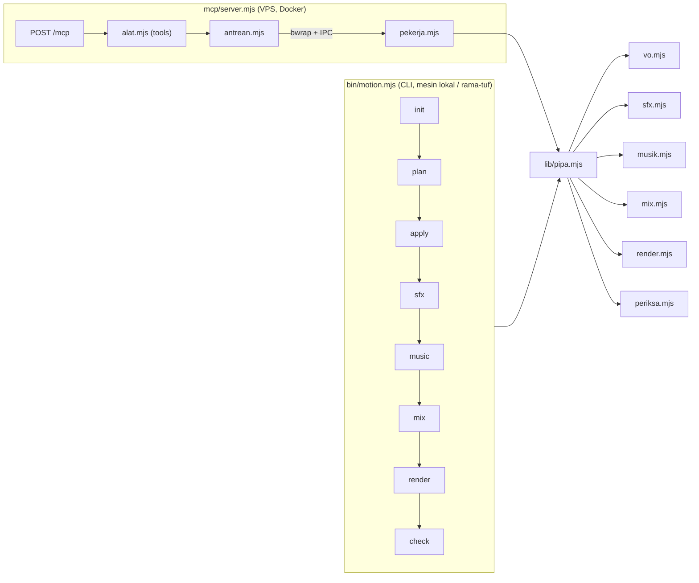

# Arsitektur motion-engine

Dokumen ini membantu menemukan berkas yang tepat untuk sebuah gejala tanpa membaca seluruh
kode. Alasan di balik tiap aturan ada di komentar kode, `README.md` ("Yang sudah dipasang, dan
kenapa"), dan `IKLAN.md`. Diagram bergambar: `docs/diagrams/motion-engine-workflow.png` dan
`motion-engine-workflow-class.png`.

## Dua pintu masuk, satu pipa

- **CLI**: config adalah modul JS (`motion.config.mjs`) dengan fungsi `cue`, `gate`, dll. VO,
  SFX, dan musik digenerate lewat ElevenLabs (`lib/el.mjs`).
- **MCP**: config adalah JSON (`config.json`); ekspresi detik berupa string dihitung oleh
  `mcp/ekspresi.mjs`, lalu `Pr.keConfig` mengubahnya menjadi objek config yang sama dengan CLI.
  Server **tidak** membuat audio; semua audio diunggah (`suara.luar`, `@luar`, `musik.luar`).
- Render MCP selalu di proses anak dalam sandbox bubblewrap (`antrean.perintahPekerja`); server
  HTTP sendiri tidak pernah menjalankan Chromium atau ffmpeg berat.

## Urutan pipa (`lib/pipa.mjs`)

| Langkah | Fungsi | Berkas | Menulis |
|---|---|---|---|
| bongkar zip | `bongkar`, `periksaZip` | `pipa.mjs` | `src/` |
| VO | `vo`, `pangkasVo`, `akhirSuara`, `ucapkan` | `vo.mjs`, `lafal.mjs` | `aset/vo/vo-NN.mp3` + `.kunci` |
| rencana | `rencana` → `tata.rencana` | `pipa.mjs`, `tata.mjs` | `timeline.json` |
| terap | `terap`, `tulisTiming` | `pipa.mjs`, `komposisi.mjs` | `OM_SCENES`, `timing.js`, JSX v1 (dari `.asli`) |
| SFX | `sfx` | `sfx.mjs`, `stok.mjs` | `aset/sfx/*.mp3` + `.kunci` |
| musik | `musik` | `musik.mjs` | `aset/<nama>.mp3` + `.kunci` |
| mix | `mix` → `mix.rakit` | `pipa.mjs`, `mix.mjs` | `aset/master.wav`, `stem/*.wav` |
| render | `render` → `render.render` | `render.mjs` | `<keluaran>.mp4`, `-sampul.jpg` |
| periksa | `periksa` | `periksa.mjs` | laporan (tanpa berkas) |

Tiap langkah aman diulang: aset generator di-cache dengan `.kunci` (`lib/kunci.mjs`) yang memuat
seluruh permintaannya, bukan sekadar "berkasnya ada".

## Peta modul

| Berkas | Tanggung jawab |
|---|---|
| `lib/pipa.mjs` | satu pintu semua tahap rantai; `rentangScene`/`namaPotongan` (render parsial), `daftarVarian`/`renderVarian` (semua rasio, P6-03) |
| `lib/subtitel.mjs` | `.srt`/`.vtt`/`-naskah.txt` dari penempatan `tata` yang sama dengan mixer (dipakai `render`, `bin/srt.mjs`, pekerja MCP) |
| `lib/konstanta.mjs` | semua ambang audio, batas zip, batas bawaan MCP, beserta sebabnya |
| `lib/tipe.mjs` | typedef JSDoc `Config`, `Scene`, `BarisVO` (hanya untuk `tsc`) |
| `lib/env.mjs` | memuat `.env`, `wajib()` |
| `lib/ff.mjs` | pembungkus ffmpeg/ffprobe: `durasi`, `volume`, `lufs`, `puncakSejati` |
| `lib/el.mjs` | klien ElevenLabs: TTS, SFX, musik, STT, kuota; golongan galat dan percobaan ulang |
| `lib/kering.mjs` | `--kering`: perkiraan durasi VO (kalibrasi proyek / `suara.kps` / bawaan), rencana, cue, biaya tanpa ElevenLabs |
| `lib/doktor.mjs` | `motion doctor`: cek prasyarat mesin (Node, ffmpeg, Playwright/Chromium, `.env`, disk/tmpfs, ElevenLabs) |
| `lib/cachevo.mjs` | cache VO lintas proyek berkunci `.kunci` VO (termasuk konteks tetangga) |
| `lib/biaya.mjs` | perkiraan biaya sebelum generate, gerbang `BIAYA_MAKS_USD`/`--ya`, `biaya.json` |
| `lib/lafal.mjs` | ejaan akronim dan domain untuk TTS |
| `lib/komposisi.mjs` | baca/tulis `OM_SCENES`, deteksi kontrak v1/v2, penambal JSX v1 |
| `lib/tata.mjs` | menempatkan baris VO dan menurunkan durasi scene (`jangkar`/`alir`) |
| `lib/timeline.mjs` | `timeline.json` kerja |
| `lib/vo.mjs`, `sfx.mjs`, `musik.mjs` | tahap generate dan pemeriksaan hasil generator |
| `lib/mix.mjs` | filtergraph ffmpeg, ducking, loudness -14 LUFS / -1 dBTP |
| `lib/render.mjs` | server statis + Chromium per frame + encode; `rentangFrame` (render parsial); `periksaVisual` (tata letak di komposisi hidup); `muatPlaywright`/`OPSI_CHROMIUM` (dipakai juga `doctor`) |
| `lib/periksa.mjs` | verifikasi hasil akhir: masking, bus SFX, hening, lubang musik, peta level, sampul, STT |
| `lib/jaring.mjs` | penjaga SSRF untuk unduhan dan halaman Chromium |
| `lib/stok.mjs` | katalog `sfx-stok/`; pencarian terurut + sinonim (`SINONIM`, `BOBOT`), `mirip` (tf-idf), `saran` |
| `mcp/server.mjs` | Express: `/mcp`, `/unduh`, `/hidup`, `/siap`, `/metrik`, retensi |
| `mcp/alat.mjs` | definisi tool MCP dan skema zod `Config` (kontrak di `mcp/PANDUAN.md`) |
| `mcp/proyek.mjs` | penyimpanan per akun, kuota, retensi, tautan bertanda tangan, `keConfig` |
| `mcp/antrean.mjs` | antrean render, sandbox bwrap, watchdog, cuplik bergiliran; `kabariWebhook` sesudah tugas berakhir; `batalkan` (antre dikeluarkan, jalan dihentikan via sinyal) |
| `mcp/admin.mjs` | dasbor `/admin` (Basic `ADMIN_TOKEN`, CSRF per tombol, semua teks di-escape, CSP tanpa skrip) |
| `mcp/webhook.mjs` | webhook render: validasi URL (https, publik), tanda HMAC per render, kirim ke IP yang diperiksa, ulang 5xx/429 |
| `mcp/pekerja.mjs` | proses anak: menjalankan pipa atau cuplik |
| `mcp/skema.mjs` | `versiSkema` dan migrasi config lama |
| `mcp/log.mjs`, `metrik.mjs`, `sehat.mjs` | log JSON, Prometheus, kesiapan |
| `mcp/auth.mjs`, `env.mjs` | verifikasi token ke bimp, rahasia wajib produksi |

## Di mana setiap cek berada

| Cek | Tempat | Kapan gagal |
|---|---|---|
| batas scene jatuh di tengah VO | `tata.mjs` | `plan` |
| VO melebihi `maks` / transkrip tidak cocok (`dengar`) | `vo.mjs` | `plan` (dilaporkan, take terbaik dipakai) |
| VO senyap sesudah trim | `vo.pangkasVo` | `plan` / `unggah` |
| SFX kosong sesudah N percobaan | `sfx.mjs` | `sfx` |
| perkiraan biaya di atas `BIAYA_MAKS_USD` | `biaya.jaga` | sebelum `plan`/`apply`/`sfx`/`music`/`mix`/`check`/`all` |
| kuota ElevenLabs habis / 4xx (tidak diulang) | `el.kirim`, `el.golongkan` | langkah yang memanggil API |
| musik berlubang (diminta ulang) | `musik.mjs` + `periksa.lubang` | `music` |
| lubang di potongan bed yang dipakai video | `musik.periksaBed` | `music` (laporan, tidak gagal) |
| teks keluar stage / terpotong, kapsi kosong, frame hitam | `render.periksaVisual` | `check` (peringatan) |
| kapsi/jangkar/deret tidak berpola | `komposisi.geser*` | `apply` |
| config v1 pada komposisi v2 | `pipa.terap` | `apply` / render MCP |
| SFX/musik belum ada | `pipa.mix` | `mix` |
| mix tidak konvergen ke -14 LUFS | `mix.mjs` | `mix` |
| zip berbahaya (traversal, bom) | `pipa.periksaZip` | `init` / `impor_zip` |
| SSRF unduhan/halaman | `jaring.mjs` | `unggah`, render |
| config JSON tidak sah / ekspresi salah | `alat.mjs` (zod) + `ekspresi.mjs` | `simpan_config` |
| disk/alat render tidak siap | `sehat.kesiapan` | `render` MCP, `/siap` |
| render macet / melebihi batas | `antrean.jalankanPekerja` | selama render MCP |
| sampul frame 0, masking, bus SFX, hening, transkrip | `periksa.mjs` | `check` / laporan render |

## Gejala → penyebab → berkas

| Gejala | Penyebab yang pernah terjadi | Lihat |
|---|---|---|
| `apply` mencetak "0 kapsi" | kapsi bukan `const caps = [...]` (inline `<Captions items>` atau tuple) | `komposisi.geserKapsi`, README "Kapsi … diubah jadi `const caps`" |
| kapsi hilang total, render sukses | alias peta cue ditulis balik sebagai `CUES` → `at` NaN | `komposisi.namaCue`, `geserKapsi` |
| retiming tidak berefek di layar | JSX yang ditambal bukan yang dipakai komposisi | `komposisi.jsxUtama` |
| animasi diam saat scene memanjang | jangkar tidak ikut digeser | `geserJangkar`/`geserDeret`, atau kontrak v2 |
| suntingan JSX hilang sesudah `apply` | `apply` selalu memulihkan dari `.asli` | `pipa.terap` (`.terap`), sunting `.asli` juga |
| nama scene aneh merusak durasi | literal `OM_SCENES` | `komposisi.cariScenes` |
| awal kata VO terpotong ("Toh" → "Love") | ambang trim terlalu ketat | `konstanta.VO`, `vo.pangkasVo` |
| ekor VO "kepotong" / ada jeda panjang | deteksi akhir suara | `vo.akhirSuara`, `konstanta.VO` |
| suara/rekaman lama dipakai sesudah revisi | cache "berkas ada" | `kunci.segar` |
| bus SFX mati tanpa peringatan | `asetpts` hilang sesudah `amix` | `mix.mjs` |
| musik "bolong" / mati di CTA | outro trek di dalam video, amplop menukik | `musik.mjs`, `mix.amplop`, IKLAN §1 |
| `check` melaporkan bed rata padahal tidak dibaca | ffmpeg gagal membaca stem | `periksa.lubang` (`galat`) |
| MP4 di atas -1 dBTP | encode AAC final berbeda dari uji | `mix.mjs` (margin 0,3 dB) |
| gambar gepeng di 4:5 / 1:1 | ukuran dari preset, bukan aspek | `render.render` |
| `Target crashed` / `Unable to capture screenshot` | `/tmp` tmpfs penuh | `render.mjs`, README `TMPDIR`, `MOTION_VIEWPORT` |
| MP4 2 detik padahal "900 frame ✓" | dua render berbagi direktori frame | `render.render` (PID di nama) |
| render MCP mati OOM di video panjang | frame di tmpfs sandbox | `antrean.perintahPekerja` (`dirKerja`) |
| `/siap` 503 | disk < `MIN_DISK_MB`, ffmpeg/Chromium hilang | `mcp/sehat.mjs` |
| `mix` gagal `amix=inputs=0` | video tanpa cue SFX (diperbaiki; dijaga `test/mix.test.mjs`) | `mix.rakit` (`senyap`) |
| perintah berhenti "di atas BIAYA_MAKS_USD" | kunci cache semua baris berubah (`suara.*`, `lafal`, model) | `biaya.perkiraan` → `vo.rencanaVo` |
| galat "VO-7 (...): kuota/kredit ElevenLabs habis" | kuota akun habis; berkas yang sudah jadi tetap di cache | `el.kirim` |
| config lama ditolak "versiSkema" | config dari server lebih baru | `mcp/skema.mjs` |
